# Implementation Plan: Antigravity 2.0+ Custom Subagent Team & Coordination Rules for `advanced_prompting_system`

## Goal Description

Design and implement a complete, repository-tailored **Google Antigravity 2.0+ Custom Agent Team** and **Modular Rules Architecture** for [`advanced_prompting_system`](file:///d:/projects/advanced_prompting_system/advanced_prompting_system).

This implementation synthesizes:
1. **Antigravity 2.0+ Customization Standards** (`agy-customizations`, `antigravity-guide`, `google-antigravity-sdk`):
   - Directory-based custom agent definitions under `.agents/agents/<name>/agent.md` with YAML frontmatter (`name`, `description`, `tools`, `mainAgent`, `subagent`, `model`, `commandExecutionPolicy`, `inheritMcp`, `skills`).
   - Progressive-disclosure rules (`trigger: always_on` vs. `trigger: model_decision`) respecting the 24 KB per-file cap and 20,000-token aggregate rules budget.
   - Hierarchical workspace entrypoints (`GEMINI.md` and `AGENTS.md`) and mirrored rule directories (`.agents/rules/` and `.agent/rules/`).
2. **Multi-Agent Orchestration & Prompt Engineering Best Practices** (`agent-orchestration-multi-agent-optimize`, `ai-agents-architect`, `prompt-engineering-patterns`, `ai-engineering-toolkit`):
   - Supervisor / Lead-Coordinator pattern with **One-Production-Writer Discipline** (specialists are read-only/diagnostic investigators; the coordinator synthesizes findings and performs surgical writes).
   - **5-Stage Orchestration Lifecycle** bookended by `memory-scout` (Stage 1 pre-flight context recovery) and `memory-steward` (Stage 5 post-verification knowledge curation via `mem0ry4ai` MCP and `memory-bank/`).
   - Explicit tool boundaries, structured output contracts, bounded retry/revision loops, and fail-closed verification gates.
3. **Reference Repository Parity** (`backrooms_lore_scraper`, `langgraph_system_generator`, `intelligent_data_detective`):
   - Direct structural and stylistic alignment with `GEMINI.md`, `AGENTS.md`, `team-coordination.md`, `antigravity-agent-team.md`, `code-architecture.md`, `validation-and-gates.md`, and `70-memory-workflow.md`.
4. **Domain-Specific Tailoring to `advanced_prompting_system`**:
   - Grounded in the actual modules ([`advanced_prompting.py`](file:///d:/projects/advanced_prompting_system/advanced_prompting_system/advanced_prompting.py), [`conversation_manager.py`](file:///d:/projects/advanced_prompting_system/advanced_prompting_system/conversation_manager.py), [`complexity_measures.py`](file:///d:/projects/advanced_prompting_system/advanced_prompting_system/complexity_measures.py), [`provider_client.py`](file:///d:/projects/advanced_prompting_system/advanced_prompting_system/provider_client.py), [`assistant_personalities.py`](file:///d:/projects/advanced_prompting_system/advanced_prompting_system/assistant_personalities.py), [`output_generator.py`](file:///d:/projects/advanced_prompting_system/advanced_prompting_system/output_generator.py), [`function_definitions.py`](file:///d:/projects/advanced_prompting_system/advanced_prompting_system/function_definitions.py), [`app.py`](file:///d:/projects/advanced_prompting_system/advanced_prompting_system/app.py), [`schema.py`](file:///d:/projects/advanced_prompting_system/advanced_prompting_system/schema.py), [`feedback_manager.py`](file:///d:/projects/advanced_prompting_system/advanced_prompting_system/feedback_manager.py), [`conftest.py`](file:///d:/projects/advanced_prompting_system/advanced_prompting_system/conftest.py), [`collaborative-assistant-frontend/`](file:///d:/projects/advanced_prompting_system/advanced_prompting_system/collaborative-assistant-frontend)), PR #34 offline qualification invariants, Issue #35/#36 roadmap items, and the socket-guarded offline test wrappers ([`tools/run-offline.ps1`](file:///d:/projects/advanced_prompting_system/advanced_prompting_system/tools/run-offline.ps1) and [`tools/run-frontend-offline.ps1`](file:///d:/projects/advanced_prompting_system/advanced_prompting_system/tools/run-frontend-offline.ps1)).

> [!NOTE]
> **Legacy Workflows Check (`/migrate-workflows`)**: Scanned both `~/.gemini/config/` and the workspace for legacy `.agents/workflows/*.md` or `workflows.json` files. None exist; all 26 workspace skills already reside in `.agents/skills/<name>/SKILL.md`.

---

## Team Architecture & Orchestration Flow

```mermaid
flowchart TD
    User["User / Engineering Task"] --> Coord["aps-repo-coordinator<br/>(Main Agent & Single Production Writer)"]

    subgraph Stage1 ["Stage 1: Pre-Flight Context Recovery"]
        Coord -->|1. Invoke before planning| MScout["memory-scout<br/>(mem0ry4ai + memory-bank/)"]
        MScout -->|Memory Brief| Coord
    end

    subgraph Stage2 ["Stage 2: Architecture & Contract Scoping"]
        Coord -->|2. Cross-module boundary check| AScout["architecture-contract-scout<br/>(LazyClient, Adapters, Schemas)"]
        AScout -->|Contract & Hazard Brief| Coord
    end

    subgraph Stage3 ["Stage 3: Parallel / Sequential Specialist Delegation"]
        Coord -->|Prompting & Reasoning| PRA["prompt-reasoning-architect<br/>(advanced_prompting.py)"]
        Coord -->|Debate, Voting & Memory| CCS["consensus-conversation-specialist<br/>(conversation_manager.py, output_generator.py)"]
        Coord -->|Complexity, NLP & Plans| CNE["complexity-nlp-engineer<br/>(complexity_measures.py)"]
        Coord -->|GraphQL & React UI| GFS["graphql-frontend-specialist<br/>(app.py, schema.py, frontend/)"]
        PRA & CCS & CNE & GFS -->|Findings & Proposed Diffs| Coord
    end

    subgraph Stage4 ["Stage 4: Implementation & Offline Qualification Gate"]
        Coord -->|3. Surgical Edits & Gate Check| OQG["offline-qa-gatekeeper<br/>(run-offline.ps1 + run-frontend-offline.ps1)"]
        OQG -->|148 Backend + 111 Frontend Verdict| Coord
    end

    subgraph Stage5 ["Stage 5: Durable Knowledge Closeout"]
        Coord -->|4. Post-Verification Closeout| MSteward["memory-steward<br/>(mem0ry4ai + memory-bank/)"]
        MSteward -->|Closeout Summary| Coord
    end
```



---

## User Review Required

> [!IMPORTANT]
> **Key Design Decisions for Review**:
> 1. **9-Agent Roster in `.agents/agents/<name>/agent.md`**:
>    - `aps-repo-coordinator` (`mainAgent: true`, `subagent: false`, `model: pro`) as the selectable lead coordinator and single production writer.
>    - 8 specialist subagents (`mainAgent: false`, `subagent: true`): `memory-scout`, `architecture-contract-scout`, `prompt-reasoning-architect`, `consensus-conversation-specialist`, `complexity-nlp-engineer`, `graphql-frontend-specialist`, `offline-qa-gatekeeper`, and `memory-steward`.
> 2. **Dual Rules Discovery (`.agents/rules/` and `.agent/rules/`)**:
>    - Rules will be written to `.agents/rules/` and mirrored in `.agent/rules/` (matching `langgraph_system_generator` and `intelligent_data_detective`) as well as documented in `.agents/doc/antigravity-agent-team.md` (matching `backrooms_lore_scraper`), ensuring seamless discovery across all Antigravity surfaces.
> 3. **Local `memory-bank/` Initialization**:
>    - Creating `memory-bank/activeContext.md`, `memory-bank/systemPatterns.md`, `memory-bank/techContext.md`, and `memory-bank/progress.md` seeded with verified PR #34 / Issue #35 Phase 2 baseline facts so `memory-scout` and `memory-steward` have immediate local files to pair with `mem0ry4ai` MCP tools.

---

## Proposed Changes

### Component 1: Root Workspace Instruction & Operating Contracts

#### [NEW] [GEMINI.md](file:///d:/projects/advanced_prompting_system/advanced_prompting_system/GEMINI.md)
- Serves as the primary Antigravity / Gemini workspace entrypoint.
- Establishes `aps-repo-coordinator` as the Lead Coordinator & Primary Engineering Steward enforcing the **One-Production-Writer** model.
- Documents the 9-agent roster table with roles, focus areas, default models, and links to `.agents/agents/<name>/agent.md`.
- Defines the **Strict 5-Stage Orchestration Lifecycle** (Stage 1: `memory-scout` -> Stage 2: Planning & `architecture-contract-scout` -> Stage 3: Domain Specialist Delegation -> Stage 4: `offline-qa-gatekeeper` Verification Gate -> Stage 5: `memory-steward` Closeout).
- References `AGENTS.md`, `.agents/rules/` (and `.agent/rules/`), `.agents/doc/antigravity-agent-team.md`, `mem0ry4ai` (`project:advanced_prompting_system`), and recommended slash commands (`/plan`, `/grill-me`, `/boost`, `/goal`, `/schedule`, `/learn`).

#### [NEW] [AGENTS.md](file:///d:/projects/advanced_prompting_system/advanced_prompting_system/AGENTS.md)
- Authoritative, tool-neutral repository operating contract modeled after `backrooms_lore_scraper/AGENTS.md`, `langgraph_system_generator/AGENTS.md`, and `intelligent_data_detective/AGENTS.md`.
- Distinguishes between **Runtime Collaborative/Prompting Personas** (the 26 debate assistants in `assistant_personalities.py` and reasoning loops in `advanced_prompting.py` / `conversation_manager.py`) and **Contributor-Facing Antigravity Agents** (`.agents/agents/*/agent.md`).
- Documents the **Repository Map**, **Execution & Surface Contracts** (`AdvancedPromptEngineer.main`, `run_conversation`, `collaborative_reasoning_main`, `invoke_collaborative_reasoning`, Strawberry GraphQL `/graphql`, React SPA), **Non-Negotiable Invariants** (Lazy SDK `LazyClient`, zero import-time network/model downloads, process-level socket denial guard, `BinaryVote`/`ConfidenceVote`/`ErrorResult` voting resilience, `ConversationMemory` round-trip compatibility, protected file writes), and **Authoritative Validation Commands** (`./tools/run-offline.ps1` and `./tools/run-frontend-offline.ps1`).

---

### Component 2: Custom Subagents in `.agents/agents/<name>/agent.md`

#### [NEW] [aps-repo-coordinator/agent.md](file:///d:/projects/advanced_prompting_system/advanced_prompting_system/.agents/agents/aps-repo-coordinator/agent.md)
- **Frontmatter**:
  ```yaml
  ---
  name: aps-repo-coordinator
  description: >
    Primary engineering coordinator and lead orchestrator for advanced_prompting_system.
    Formulates architectural plans, coordinates specialized subagents across the 5-stage
    lifecycle, enforces the one-production-writer model, and preserves offline-qualified
    lazy-SDK, multi-agent consensus, complexity planning, and GraphQL/React contracts.
  tools:
    - view_file
    - write_to_file
    - replace_file_content
    - multi_replace_file_content
    - list_dir
    - grep_search
    - find_by_name
    - run_command
    - invoke_subagent
    - send_message
    - manage_subagents
    - define_subagent
  mainAgent: true
  subagent: false
  model: pro
  commandExecutionPolicy: sandbox
  inheritMcp: true
  skills:
    - ai-agents-architect
    - agent-orchestration-multi-agent-optimize
    - prompt-engineering-patterns
    - ai-engineering-toolkit
    - python-pro
  ---
  ```
- **System Prompt**: Instructs the coordinator on the One-Production-Writer model, cross-surface consistency (`AdvancedPromptEngineer.main`, `run_conversation`, Flask/Strawberry GraphQL `/graphql`, and React frontend), the 5-stage orchestration lifecycle, parallel vs. sequential subagent dispatch, offline guard verification via `./tools/run-offline.ps1` and `./tools/run-frontend-offline.ps1`, and reactive wakeup discipline.

#### [NEW] [memory-scout/agent.md](file:///d:/projects/advanced_prompting_system/advanced_prompting_system/.agents/agents/memory-scout/agent.md)
- **Frontmatter**: `mainAgent: false`, `subagent: true`, `model: flash`, `commandExecutionPolicy: sandbox`, `inheritMcp: true`, `tools: [view_file, list_dir, grep_search, call_mcp_tool]`, `skills: [recursive-context-pruning-token-budgeting]`.
- **System Prompt**: Read-only pre-flight context recovery specialist. Queries `mem0ry4ai` (`memory_resume`, `memory_search`, `memory_get`, `session_search` under `project:advanced_prompting_system`) and inspects `memory-bank/` and `docs/pr34-offline-qualification.md`. Outputs a structured **Memory Brief** (`Active Tasks & Milestones`, `Relevant Prior Decisions`, `Known Gotchas & Hazards`, `Conflicts / Staleness`, `Scout Recommendations`), explicitly treating memory as context subordinate to current repository evidence.

#### [NEW] [architecture-contract-scout/agent.md](file:///d:/projects/advanced_prompting_system/advanced_prompting_system/.agents/agents/architecture-contract-scout/agent.md)
- **Frontmatter**: `mainAgent: false`, `subagent: true`, `model: flash`, `commandExecutionPolicy: sandbox`, `inheritMcp: true`, `tools: [view_file, list_dir, grep_search, find_by_name]`, `skills: [ai-agents-architect, code-simplification, pydantic-models-py]`.
- **System Prompt**: Pre-implementation read-only scout modeled on `backrooms_lore_scraper`'s `architecture-contract-scout`. Audits cross-module seams before code edits:
  - `PlanStep` caller mapping from `AdvancedPromptEngineer.main()` -> `invoke_collaborative_reasoning()` / `collaborative_reasoning_main()` -> `conversation_manager.run_conversation()`.
  - Tuple return contract `(conversation_history, questions_asked, final_output)` across `conversation_manager.py`, `advanced_prompting.py`, and `schema.py`.
  - Import-time side-effect prohibitions (`provider_client.LazyClient`, no eager `openai.OpenAI()`, no import-time NLTK downloads or `spacy.load()`).
  - Separation between supported production modules and historical/non-certifying files (`test_b.py`, `test_c.py`, `output_generator_backup.py`, `output_generator_fixed.py`, `historical_verification/`, finance/meeting demo scripts).

#### [NEW] [prompt-reasoning-architect/agent.md](file:///d:/projects/advanced_prompting_system/advanced_prompting_system/.agents/agents/prompt-reasoning-architect/agent.md)
- **Frontmatter**: `mainAgent: false`, `subagent: true`, `model: pro`, `commandExecutionPolicy: sandbox`, `inheritMcp: true`, `tools: [view_file, list_dir, grep_search, find_by_name, run_command]`, `skills: [prompt-engineering-patterns, ai-engineering-toolkit, llm-structured-output, pydantic-models-py, python-pro]`.
- **System Prompt**: Specialist for [`advanced_prompting.py`](file:///d:/projects/advanced_prompting_system/advanced_prompting_system/advanced_prompting.py):
  - `AdvancedPromptEngineer`, `PromptEngineeringConfig`, `Task`, `Step`, `Reflection`, `Interaction`, `FinalStepOutput`, `FinalPlanStepOutput`, `CompletionStatus`.
  - Prompting & search strategies: `self_consistency`, `automatic_chain_of_thought`, `least_to_most`, `progressive_hint`, `dynamic_confidence_exploration`, and upcoming Tree-of-Thoughts (`#36`).
  - XML tag parser & step consolidation invariants (`<count>`, `<thinking>`, `<step>`, `<reflection>`, `<reward>`, `<agent_response>`): handling malformed/unclosed tags, non-numeric counts/rewards, empty step descriptions before embedding, deduplicated reflection combiners, and insertion-order preservation in `consolidate_steps` and `merge_interactions`.
  - Step judging & completion (`judge_step`, `judge_step_completion` boolean unpacking, `choose_best_response` via `client.beta.chat.completions.parse`).
  - Offline tiktoken token-counting fallback (`count_tokens` catching `NetworkForbidden` / encoding load failures).

#### [NEW] [consensus-conversation-specialist/agent.md](file:///d:/projects/advanced_prompting_system/advanced_prompting_system/.agents/agents/consensus-conversation-specialist/agent.md)
- **Frontmatter**: `mainAgent: false`, `subagent: true`, `model: pro`, `commandExecutionPolicy: sandbox`, `inheritMcp: true`, `tools: [view_file, list_dir, grep_search, find_by_name, run_command]`, `skills: [ai-agents-architect, llm-structured-output, pydantic-models-py, python-pro]`.
- **System Prompt**: Specialist for [`conversation_manager.py`](file:///d:/projects/advanced_prompting_system/advanced_prompting_system/conversation_manager.py), [`assistant_personalities.py`](file:///d:/projects/advanced_prompting_system/advanced_prompting_system/assistant_personalities.py), [`output_generator.py`](file:///d:/projects/advanced_prompting_system/advanced_prompting_system/output_generator.py), and [`function_definitions.py`](file:///d:/projects/advanced_prompting_system/advanced_prompting_system/function_definitions.py):
  - Voting & Consensus Invariants: `cast_binary_vote` -> `Union[BinaryVote, ErrorResult]`, `cast_confidence_vote` -> `Union[ConfidenceVote, ErrorResult]`. Never treat `BinaryVote(vote=False)` or `ErrorResult` as truthy affirmative votes (`isinstance(v, BinaryVote) and v.vote is True`).
  - Edge-case consensus protocols: Partial-majority problem definition selection (`define_problem`), tie-vote mediator tie-breaker (`MediatorReviseOrDecide`), low-participation finalization, majority-NO / weak-YES routing through mediator revision, and all-error continuation vote bounded fallback.
  - `ConversationMemory` contracts: Typed `ArgumentItem`, `DecisionItem`, `ToDoItem` models with dict-style backward compatibility (`__getitem__`, `.get()`), legacy list/string deserialization round-trips (`from_dict` / `to_dict`), and memory compaction.
  - Message safety & Output generation: `normalize_message` raising `ValueError` on `ErrorResult` objects; all 7 file write functions in `output_generator.py` wrapped in `try/except (IOError, OSError, PermissionError)`.

#### [NEW] [complexity-nlp-engineer/agent.md](file:///d:/projects/advanced_prompting_system/advanced_prompting_system/.agents/agents/complexity-nlp-engineer/agent.md)
- **Frontmatter**: `mainAgent: false`, `subagent: true`, `model: inherit`, `commandExecutionPolicy: sandbox`, `inheritMcp: true`, `tools: [view_file, list_dir, grep_search, find_by_name, run_command]`, `skills: [scikit-learn, python-pro, pydantic-models-py]`.
- **System Prompt**: Specialist for [`complexity_measures.py`](file:///d:/projects/advanced_prompting_system/advanced_prompting_system/complexity_measures.py):
  - `Plan`, `PlanStep`, `Subtask` schema contracts and `assess_complexity` / `adjust_step_budget` integration.
  - Lazy NLP & Optional Dependency Invariants: All 5 direct spaCy consumers (`is_real_words`, `is_complex_graph`, `is_complex_recursive`, `is_complex_ast`, `is_complex_llm`) must resolve `get_nlp_spacy()` lazily and return safe defaults (`0.0` or original text) without calling LLM providers when `en_core_web_sm` is absent.
  - Lexical filtering (`is_real_words`): Gracefully handles missing NLTK `punkt`/`wordnet`/`cmudict` corpora (`LookupError`) by preserving input text.
  - Embeddings & Similarity: `cosine_similarity_custom` supporting lists, `np.ndarray`, and `scipy.sparse.csr_matrix` with zero-magnitude protection; `get_embedding` raising explicit `RuntimeError` when unconfigured in live mode (`OFFLINE_MODE=0`) while providing deterministic seeded vectors in `OFFLINE_MODE=1`.
  - ML Complexity Model: `ml_complexity_model.pkl` (`TfidfVectorizer` + `LogisticRegression`) fallback and safe local logging.

#### [NEW] [graphql-frontend-specialist/agent.md](file:///d:/projects/advanced_prompting_system/advanced_prompting_system/.agents/agents/graphql-frontend-specialist/agent.md)
- **Frontmatter**: `mainAgent: false`, `subagent: true`, `model: inherit`, `commandExecutionPolicy: sandbox`, `inheritMcp: true`, `tools: [view_file, list_dir, grep_search, find_by_name, run_command]`, `skills: [graphql, graphql-schema, senior-frontend, tailwind-design-system, fixing-accessibility, vitest-skill, api-security-best-practices]`.
- **System Prompt**: Specialist for [`app.py`](file:///d:/projects/advanced_prompting_system/advanced_prompting_system/app.py), [`schema.py`](file:///d:/projects/advanced_prompting_system/advanced_prompting_system/schema.py), [`feedback_manager.py`](file:///d:/projects/advanced_prompting_system/advanced_prompting_system/feedback_manager.py), and [`collaborative-assistant-frontend/`](file:///d:/projects/advanced_prompting_system/advanced_prompting_system/collaborative-assistant-frontend):
  - Strawberry GraphQL contract (`schema.py`): `Query.hello`, `Mutation.run_conversation(conversation, assistant_personalities, leadPersonality, num_rounds)` -> `RunConversationResponse(conversation, questions, final_output)`, and `Mutation.submit_feedback` -> `FeedbackResponse`.
  - Question mapping resilience: Maps both `q.get("question")` and `q.get("reply")` to `Question.question`.
  - React 19 + TypeScript + Apollo Client frontend (`collaborative-assistant-frontend/src/`): `ConversationPage`, `AssistantConfigPanel`, `ChatInput`, `ConversationDisplay`, `FeedbackDisplay`, `MessageBubble`, `useRunConversation`, `useSubmitFeedback`.
  - Frontend verification & lint debt tracking: Runs `./tools/run-frontend-offline.ps1 -Action test|lint|build|guard` and tracks the 13 known ESLint errors / 1 warning for clean resolution.

#### [NEW] [offline-qa-gatekeeper/agent.md](file:///d:/projects/advanced_prompting_system/advanced_prompting_system/.agents/agents/offline-qa-gatekeeper/agent.md)
- **Frontmatter**: `mainAgent: false`, `subagent: true`, `model: pro`, `commandExecutionPolicy: sandbox`, `inheritMcp: true`, `tools: [view_file, list_dir, grep_search, find_by_name, run_command]`, `skills: [python-testing-patterns, vitest-skill, github-actions-advanced, backend-security-coder]`.
- **System Prompt**: Independent test designer, offline runtime diagnostician, and adversarial release gatekeeper governing [`provider_client.py`](file:///d:/projects/advanced_prompting_system/advanced_prompting_system/provider_client.py), [`conftest.py`](file:///d:/projects/advanced_prompting_system/advanced_prompting_system/conftest.py), [`tools/run-offline.ps1`](file:///d:/projects/advanced_prompting_system/advanced_prompting_system/tools/run-offline.ps1), [`tools/run-frontend-offline.ps1`](file:///d:/projects/advanced_prompting_system/advanced_prompting_system/tools/run-frontend-offline.ps1), [`tools/offline/`](file:///d:/projects/advanced_prompting_system/advanced_prompting_system/tools/offline), and [`.github/workflows/test.yml`](file:///d:/projects/advanced_prompting_system/advanced_prompting_system/.github/workflows/test.yml):
  - Enforces that bare `pytest` fails closed without `sys._aps_network_guard = True` (`tools/offline/sitecustomize.py`).
  - Verifies that `forbid_unconfigured_provider` and `isolated_runtime_directory` remain active in `conftest.py`.
  - Runs the full offline backend gate (`./tools/run-offline.ps1 -PytestArgs '-q'`, expecting 148 passed / 0 failed) and frontend gate (`./tools/run-frontend-offline.ps1 -Action guard` and `-Action test`, expecting 111 passed / 0 failed, plus `-Action build` and `-Action lint`).
  - Designs minimal red-green test cases and adversarial state matrices without editing production files.
  - Emits structured Gatekeeper Verdicts (`Blocking Findings`, `Non-Blocking Findings`, `Verification Evidence`, `Scope/Contract Assessment`, `Verdict: READY / NOT READY`).

#### [NEW] [memory-steward/agent.md](file:///d:/projects/advanced_prompting_system/advanced_prompting_system/.agents/agents/memory-steward/agent.md)
- **Frontmatter**: `mainAgent: false`, `subagent: true`, `model: inherit`, `commandExecutionPolicy: sandbox`, `inheritMcp: true`, `tools: [view_file, write_to_file, replace_file_content, list_dir, grep_search, find_by_name, call_mcp_tool]`, `skills: [recursive-context-pruning-token-budgeting]`.
- **System Prompt**: Post-verification durable knowledge curation specialist modeled after `backrooms_lore_scraper` and `langgraph_system_generator`. Runs in Stage 5 after all implementation, review, and offline qualification checks settle. Searches `mem0ry4ai` (`project:advanced_prompting_system`) before writing, supersedes stale records rather than duplicating, uses agent-neutral second-person phrasing, and updates `memory-bank/activeContext.md`, `progress.md`, and `systemPatterns.md`.

---

### Component 3: Team Coordination, Architecture, Validation & Memory Rules (`.agents/rules/`, `.agent/rules/`, and `.agents/doc/`)

> [!NOTE]
> To satisfy Antigravity's `.agents/rules/` discovery and the explicit prompt requirement for `.agent/rules/` and `.agents/doc/antigravity-agent-team.md`, we will place the canonical rules in `.agents/rules/`, mirror them in `.agent/rules/`, and place the team architecture document in `.agents/doc/antigravity-agent-team.md`.

#### [NEW] [team-coordination.md](file:///d:/projects/advanced_prompting_system/advanced_prompting_system/.agents/rules/team-coordination.md) (and `.agent/rules/team-coordination.md`)
- Frontmatter: `trigger: model_decision`, `description: "Multi-agent team coordination protocols, subagent dispatch matrix, 5-stage orchestration lifecycle, and one-writer discipline for advanced_prompting_system engineering tasks."`
- Defines the Primary Coordinator persona (`aps-repo-coordinator`), the 9-agent routing matrix, the 5-stage orchestration lifecycle, parallel vs. sequential dispatch rules, standardized subagent report contracts, one-production-writer discipline, and reactive wakeup.

#### [NEW] [antigravity-agent-team.md](file:///d:/projects/advanced_prompting_system/advanced_prompting_system/.agents/rules/antigravity-agent-team.md) (and `.agent/rules/antigravity-agent-team.md` + `.agents/doc/antigravity-agent-team.md`)
- Modeled directly on `backrooms_lore_scraper/.agents/rules/antigravity-agent-team.md` and `.agents/doc/antigravity-agent-team.md`.
- Documents Team Shape, One-Writer Rule, Suggested 10-step Workflow, Example Delegation Flow diagram, Antigravity 2.0+ `.agents/agents/<name>/agent.md` discovery, Skills & MCP integration (`mem0ry4ai`, `aas-core`), and Safety Notes.

#### [NEW] [code-architecture.md](file:///d:/projects/advanced_prompting_system/advanced_prompting_system/.agents/rules/code-architecture.md) (and `.agent/rules/code-architecture.md`)
- Frontmatter: `trigger: always_on`, `description: "Non-negotiable architectural invariants, lazy SDK loading, offline runtime guards, voting semantics, ConversationMemory contracts, and GraphQL/React parity."`
- Codifies the 6 core architectural invariants of `advanced_prompting_system`:
  1. Lazy SDK & Zero Import-Time Side Effects (`provider_client.LazyClient`, lazy `spacy`/`nltk`/transformers).
  2. Offline Socket/DNS Guard & Test Isolation (`tools/offline/sitecustomize.py`, `conftest.py` `tmp_path` chdir).
  3. Multi-Agent Voting & Mediator Resilience (`BinaryVote(vote=False)` truthiness trap, `ErrorResult` isolation, tie/low-participation/majority-NO mediator routing).
  4. `PlanStep` & Collaborative Adapter Contract (`AdvancedPromptEngineer.main` -> `invoke_collaborative_reasoning` -> `run_conversation` 3-tuple).
  5. `ConversationMemory` & Protected Output Generation (`ArgumentItem`/`DecisionItem`/`ToDoItem` round-trips, `normalize_message` rejecting `ErrorResult`, `try/except` on all 7 file writers).
  6. GraphQL & React Frontend Contract Parity (`schema.py` vs. `collaborative-assistant-frontend/src/graphql/`).

#### [NEW] [validation-and-gates.md](file:///d:/projects/advanced_prompting_system/advanced_prompting_system/.agents/rules/validation-and-gates.md) (and `.agent/rules/validation-and-gates.md`)
- Frontmatter: `trigger: model_decision`, `description: "Mandatory offline qualification test commands, socket-denial guard checks, backend pytest suites, and frontend Vitest/ESLint/Vite gates."`
- Documents the exact PowerShell and Bash offline wrapper commands, expected pass counts (148 backend passed / 0 failed; 111 frontend passed / 0 failed), per-suite breakdown, and CI parity (`.github/workflows/test.yml`).

#### [NEW] [70-memory-workflow.md](file:///d:/projects/advanced_prompting_system/advanced_prompting_system/.agents/rules/70-memory-workflow.md) (and `.agent/rules/70-memory-workflow.md`)
- Frontmatter: `trigger: model_decision`, `description: "mem0ry4ai durable cross-session memory workflow, authority order, and memory-scout / memory-steward bookend checkpoints."`
- Modeled on `backrooms_lore_scraper/.agents/rules/70-memory-workflow.md`, tailored to `project:advanced_prompting_system` and `memory-bank/`.

---

### Component 4: Local `memory-bank/` Bootstrap

#### [NEW] [memory-bank/activeContext.md](file:///d:/projects/advanced_prompting_system/advanced_prompting_system/memory-bank/activeContext.md)
#### [NEW] [memory-bank/systemPatterns.md](file:///d:/projects/advanced_prompting_system/advanced_prompting_system/memory-bank/systemPatterns.md)
#### [NEW] [memory-bank/techContext.md](file:///d:/projects/advanced_prompting_system/advanced_prompting_system/memory-bank/techContext.md)
#### [NEW] [memory-bank/progress.md](file:///d:/projects/advanced_prompting_system/advanced_prompting_system/memory-bank/progress.md)
- Initializes the local `memory-bank/` directory with current project state (PR #34 offline qualification, Issue #35 Phase 2 completion with 148 backend tests and 111 frontend tests passing offline, and remaining Issue #35/#36 roadmap items) so `memory-scout` and `memory-steward` operate seamlessly out of the box.

---

## Verification Plan

### Automated Validation
1. **Verify Custom Agent YAML Frontmatter & File Structure**:
   - Run a Python verification script to parse the YAML frontmatter of all 9 `.agents/agents/<name>/agent.md` files and all rule files in `.agents/rules/` and `.agent/rules/`, asserting required keys (`name`, `description`, `tools`, `mainAgent`, `subagent`, `model`, `commandExecutionPolicy`, `skills`), valid skill references against `.agents/skills/`, file sizes well under the 24 KB rule limit, and zero mirror drift between `.agents/rules/` and `.agent/rules/`.
2. **Run Authoritative Backend Offline Test Suite**:
   ```powershell
   ./tools/run-offline.ps1 -PytestArgs '-q'
   ```
   Confirm all 148 backend tests pass with zero network calls.
3. **Run Authoritative Frontend Offline Guard & Test Suite**:
   ```powershell
   ./tools/run-frontend-offline.ps1 -Action guard
   ./tools/run-frontend-offline.ps1 -Action test
   ```
   Confirm the Node network denial guard passes and all 111 Vitest tests pass.

### Manual Verification
- Open Antigravity 2.0's **Skills & Customizations** / **Subagents** panel in the workspace to verify that `aps-repo-coordinator` appears as a selectable main agent and the 8 specialist subagents (`memory-scout`, `architecture-contract-scout`, `prompt-reasoning-architect`, `consensus-conversation-specialist`, `complexity-nlp-engineer`, `graphql-frontend-specialist`, `offline-qa-gatekeeper`, `memory-steward`) are discovered.
